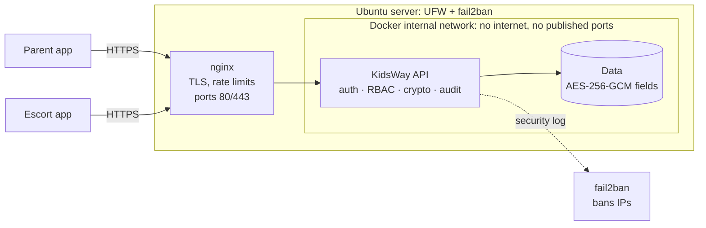

# KidsWay Secure Platform

**Security-first backend and network design for a children's escort service.**

KidsWay lets parents book a trusted escort who takes their child from point A to point B and hands them over to a named person. That means the system holds a child's **live location, health notes, photos, and the code that decides who may take the child**. This project builds the backend and infrastructure for that service with security as the main requirement, then attacks it to prove the defences work.

> Portfolio project by Isa. The product (website and app prototype) was designed for a university startup course; this repository is my own security engineering work on top of it.

  

## Results at a glance

The same attacks were run against a naive first design (v0) and the hardened version (v1). Raw output: [`docs/evidence/attack-results.txt`](docs/evidence/attack-results.txt).

| Attack | v0 (naive) | v1 (hardened) |
|---|---|---|
| Guess the handover code to take a child | **Cracked in 5.7 s** (8,460 guesses) | Blocked: stop locks after 5 tries, parent re-issues |
| Guess the SMS login code (account takeover) | **Taken over in 1.4 s** | Blocked: code burned after 5 tries |
| Read another family's child record (IDOR) | **Leaked medical data** | 404, attempt audited |
| Extend or forge a photo link | n/a | All 4 tampering attempts refused (403) |
| Request SMS codes in a loop | unlimited | 1 sent, then 429 |

Full write-up: [**Security assessment report**](docs/pentest-report.md).

## What is inside

| Area | What I built | Files |
|---|---|---|
| Threat modelling | Assets, data-flow diagram with trust boundaries, STRIDE table mapped to controls and tests, risk before/after, Malaysian PDPA notes | [`docs/threat-model.md`](docs/threat-model.md) |
| Network design | Segmented lab (VirtualBox + Docker), IP plan, firewall rule table, production VPC design with public/private/isolated subnets and VPN-only admin | [`docs/network-design.md`](docs/network-design.md) |
| Secure API | Node.js + TypeScript, zero third-party runtime dependencies | [`src/`](src/) |
| Hardening | nginx (TLS 1.2/1.3, HSTS, rate limits, path allow-list), Docker (non-root, read-only, no capabilities, internal network), UFW, fail2ban | [`deploy/`](deploy/), [`Dockerfile`](Dockerfile) |
| Working app | Installable web app (PWA) for parents, escorts and admins: OpenStreetMap map with address search, one-time trips there and back, weekly plans, live location, photo reports, admin prices | [`public/`](public/) |
| Verification | 35 automated tests (25 security + 10 feature tests that each check the feature's security rule), 4 attack scripts, TCP port scanner | [`test/`](test/), [`attacks/`](attacks/) |
| Lab guide | Step-by-step build on Windows + VirtualBox, with nmap and fail2ban checks | [`docs/lab-guide.md`](docs/lab-guide.md) |

## Architecture



## Security controls

**Identity**
- Phone login with a 6-digit one-time SMS code: 5-minute lifetime, burned after 5 wrong tries, bound to the number, same response for known and unknown numbers.
- Opaque 256-bit session tokens; only their SHA-256 is stored; 30-minute idle and 12-hour absolute timeout; logout revokes.
- Roles: parent, escort, admin. Sign-up can only create parents.

**Authorisation**
- Object-level checks on every trip, stop and child (protects against OWASP API #1, BOLA/IDOR). Unauthorised access returns 404.
- Escorts see a child only while assigned to an open trip, and never the date of birth or receiver phone numbers.

**The handover code** (the core safety feature)
- One code per drop-off stop, 6 digits from a CSPRNG, stored only as HMAC-SHA256.
- Single use, expires, locks after 5 wrong tries, 10 checks per minute per escort; only the parent can re-issue.

**Data protection**
- AES-256-GCM for names, dates of birth, medical notes, addresses, receiver names and phone numbers, with the table/column/row as authenticated data so ciphertext cannot be moved between records.
- Phone numbers stored as HMAC for lookup; key rotation supported.
- Live location accepted only during a trip and **deleted when the trip completes**.
- Handover photos served only by 5-minute HMAC-signed links; uploads checked by file signature.
- Append-only audit log (database triggers block edits and deletes).

**HTTP and infrastructure**
- Strict input validation, prepared SQL statements, body size limits, JSON only.
- CSP, nosniff, frame denial, no-store, no server banner; generic error messages.
- nginx: TLS 1.2/1.3 only, HSTS, two rate-limit zones, only `/api`, `/media` and `/healthz` routed.
- Docker: API on an `internal` network with no published ports; containers non-root, read-only, all capabilities dropped.
- UFW default deny, SSH only from the admin network; fail2ban bans IPs from the API's security log.
- **Zero third-party runtime dependencies** (Node's built-in HTTP, crypto, SQLite and test runner): no supply-chain packages to audit.

## The app


A mobile-first web app that installs on a phone like a normal app (PWA). Data is saved in `data/kidsway.db` and stays after restarts.

**Parent**
- *Where should your child go?* Pick each point on a real map (OpenStreetMap): search a school or street, or move the map under the pin like Grab.
- **One-time trip** A → B → C, with a trusted person per stop, or **there and back** on one booking (the way back gets its own code).
- **Regular plan**: choose weekdays, one way or there and back, times, different times on some days (e.g. Friday), start and end date. Trips are created a week ahead with the same escort.
- Live escort location on the map, photo report, confirm the handover. Cancel before the trip starts. Pause, resume or end plans.
- Children with encrypted health notes; home address as the default pick-up.

**Escort**: assigned trips, start, share GPS (or simulate driving for a demo), check the receiver's code, take the photo with the phone camera (resized and stripped of metadata on the phone).

**Admin**: dispatch (assign trips and regular escorts), escorts, **prices** (base, per extra child, per extra stop, weekly discount; the server calculates every price), audit log.

### Try it on one computer

`npm run dev`, then open **http://localhost:3000**. Each browser tab is a separate user:

1. **Admin**: `+60100000000` → *Escorts* → add an escort.
2. **Parent**: any `+60` number → add a child → *Home* → *One-time trip* or *Regular plan*.
3. **Admin**: *Trips* → assign; *Plans* → set the regular escort.
4. **Escort**: log in with the escort's number → start → *Simulate driving* → enter the code → photo.
5. **Parent**: watch the escort on the map, view the photo, confirm. The trip completes and the location history is deleted.

In development the SMS code is shown on screen ("SMS simulator"). To send real SMS set `SMS_PROVIDER=twilio` and the Twilio keys (see `src/sms.ts`).

### Install on a phone

Browsers install an app only over HTTPS (or on `localhost`). Run the lab deployment with nginx (see the lab guide) and open `https://192.168.56.10` on a phone in the same network, or deploy to a server with a real certificate, then choose *Install app* / *Add to Home screen*. The service worker caches only the public app files, never API data or photos.

### Page security

Strict Content-Security-Policy (no inline code; only this server plus the two OpenStreetMap hosts for tiles and address search), all server data inserted as text (no XSS), session token per tab, GPS and camera allowed only for this origin.

## Run it

Requires **Node.js 22.18 or newer**. No `npm install` needed.

```bash
npm run dev                 # app + API on http://localhost:3000 (data saved in data/)
npm test                    # 35 tests
npm run attack:handover     # each attack runs against v0 and v1
npm run attack:otp
npm run attack:idor
npm run attack:photo-url
npm start                   # API on http://127.0.0.1:3000 (dev keys, in-memory limits)
```

Full deployment with nginx, Docker, firewall and fail2ban: [`docs/lab-guide.md`](docs/lab-guide.md).

## API overview

| Method and path | Who | Purpose |
|---|---|---|
| `POST /api/auth/otp/request`, `/verify`, `/logout` | anyone / user | SMS login |
| `GET /api/me` | user | Own profile (phone masked) |
| `POST/GET /api/children`, `GET/DELETE /api/children/:id` | parent (escort: read during trip) | Child profiles, PDPA erasure |
| `PATCH /api/me` | user | Name, home address (encrypted) |
| `GET /api/settings`, `POST /api/quote` | user | Price list, server-side price |
| `POST /api/trips`, `GET /api/trips`, `GET /api/trips/:id` | parent, escort, admin | Trips A → B → C with map points and a receiver per stop; optional `back` for there and back |
| `POST /api/trips/:id/cancel` | parent, admin | Cancel before the trip starts |
| `POST/GET /api/plans`, `GET /api/plans/:id`, `POST /api/plans/:id/status` | parent (admin reads) | Weekly plans: days, times, per-day times, dates; pause, resume, end |
| `POST /api/trips/:id/start` | escort | Start an assigned trip |
| `POST /api/trips/:id/location`, `GET` | escort writes, parent reads | Live location, active trips only |
| `POST /api/trips/:id/stops/:seq/handover` | escort | Check the receiver's code |
| `POST /api/trips/:id/stops/:seq/reissue-code` | parent | New code after a lock |
| `POST /api/trips/:id/stops/:seq/photo`, `GET .../photo-url` | escort / parent | Photo report, signed link |
| `POST /api/trips/:id/stops/:seq/confirm` | parent | Confirm handover; last one completes the trip |
| `POST /api/admin/escorts`, `/api/admin/trips/:id/assign`, `/api/admin/plans/:id/assign`, `PUT /api/admin/settings`, `GET /api/admin/audit` | admin | Staff, dispatch, regular escorts, prices, audit log |

## Lab results

_Fill in after running the lab guide on your own machine._

- [ ] `docker compose ps`: only nginx publishes ports
- [ ] nmap from Windows: 22/80/443 open, 3000 not visible
- [ ] nmap `ssl-enum-ciphers`: only TLS 1.2 and 1.3
- [ ] fail2ban banned the Windows host after repeated bad logins
- [ ] API container cannot reach the internet

Screenshots: `docs/evidence/screenshots/`

## Limits and next steps

Honest scope notes are in the [threat model](docs/threat-model.md#7-out-of-scope--known-limits) and [report](docs/pentest-report.md#4-residual-risks-and-recommendations): in-memory rate limits (Redis next), SQLite instead of PostgreSQL in its own subnet, polling instead of WebSockets, free OpenStreetMap services instead of a paid or self-hosted map, SMS as the only login factor, keys in an `.env` file instead of a KMS.

## Skills shown

Threat modelling (STRIDE, DFD, risk rating) · secure API design (OWASP API Top 10) · applied cryptography (AES-GCM with AAD, HMAC, CSPRNG, constant-time comparison) · authentication and session management · network segmentation and firewall design · TLS configuration · reverse proxy and rate limiting · container hardening · intrusion prevention (fail2ban) · security testing and attack scripting · writing a security assessment report · privacy by design (PDPA).
