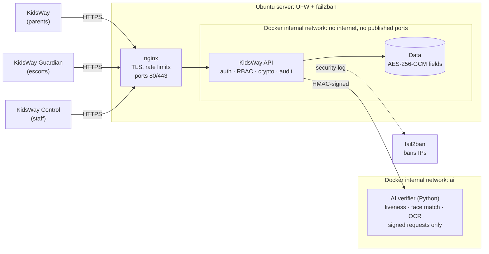
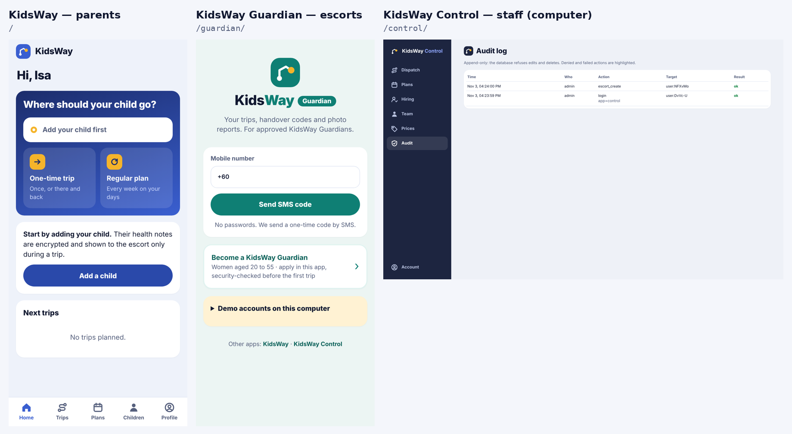
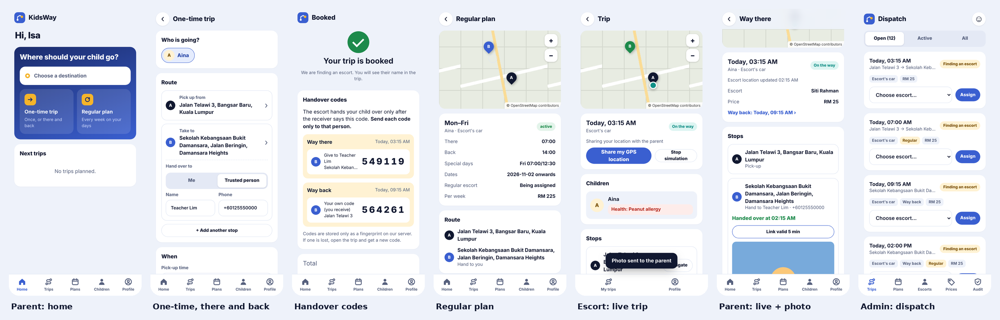
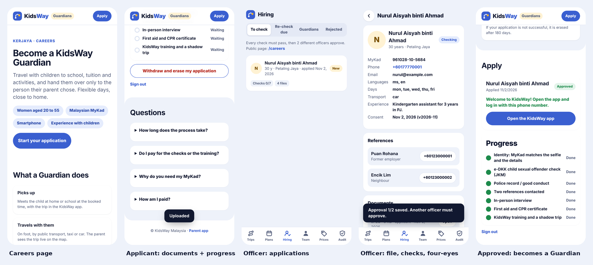
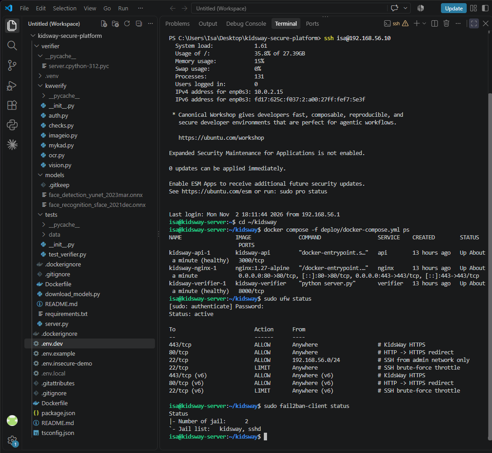
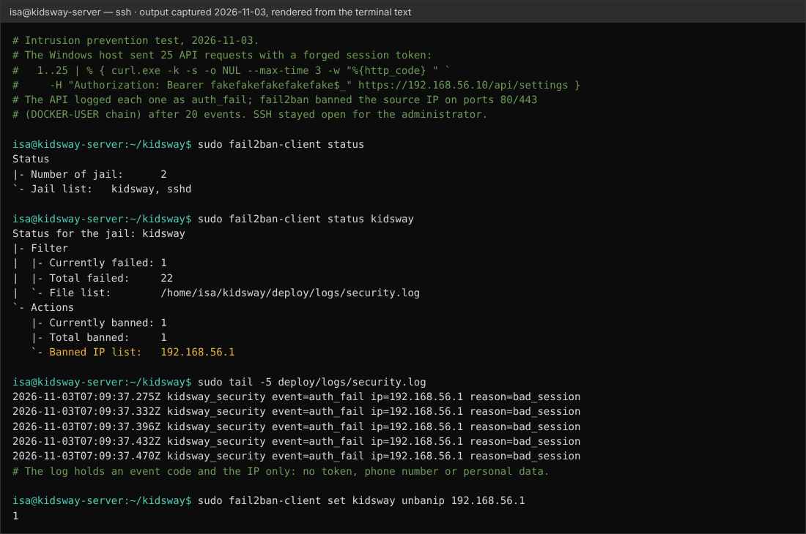

# KidsWay Secure Platform

**Security-first backend and network design for a children's escort service.**

KidsWay lets parents book a trusted escort who takes their child from point A to point B and hands them over to a named person. That means the system holds a child's **live location, health notes, photos, and the code that decides who may take the child**. This project builds the backend and infrastructure for that service with security as the main requirement, then attacks it to prove the defences work.

> Portfolio project by Isa. The product (website and app prototype) was designed for a university startup course; this repository is my own security engineering work on top of it.

  

## Results at a glance

The same attacks were run against a naive first design (v0) and the hardened version (v1). Raw output: [`docs/evidence/attack-results.txt`](docs/evidence/attack-results.txt).

| Attack | v0 (naive) | v1 (hardened) |
|---|---|---|
| Guess the handover code to take a child | **Cracked in 5.7 s** (8,460 guesses) | Blocked: stop locks after 5 tries, parent re-issues |
| Guess the SMS login code (account takeover) | **Taken over in 1.4 s** | Blocked: code burned after 5 tries |
| Read another family's child record (IDOR) | **Leaked medical data** | 404, attempt audited |
| Extend or forge a photo link | n/a | All 4 tampering attempts refused (403) |
| Request SMS codes in a loop | unlimited | 1 sent, then 429 |

Full write-up: [**Security assessment report**](docs/pentest-report.md).

## What is inside

| Area | What I built | Files |
|---|---|---|
| Threat modelling | Assets, data-flow diagram with trust boundaries, STRIDE table mapped to controls and tests, risk before/after, Malaysian PDPA notes | [`docs/threat-model.md`](docs/threat-model.md) |
| Network design | Segmented lab (VirtualBox + Docker), IP plan, firewall rule table, production VPC design with public/private/isolated subnets and VPN-only admin | [`docs/network-design.md`](docs/network-design.md) |
| Secure API | Node.js + TypeScript, zero third-party runtime dependencies | [`src/`](src/) |
| Hardening | nginx (TLS 1.2/1.3, HSTS, rate limits, path allow-list), Docker (non-root, read-only, no capabilities, internal network), UFW, fail2ban | [`deploy/`](deploy/), [`Dockerfile`](Dockerfile) |
| Three apps, one API | **KidsWay** for parents, **KidsWay Guardian** for escorts (job application included), **KidsWay Control** for staff, like a ride-hailing company. Each role signs in only in its own app, sessions are bound to the app, staff sessions expire after 15 idle minutes, and each page loads only its own code and device permissions | [`public/`](public/), [`test/apps.test.ts`](test/apps.test.ts) |
| Working app | Installable web apps (PWA): OpenStreetMap map with address search, one-time trips there and back, weekly plans, live location, photo reports, admin prices | [`public/`](public/) |
| Guardian hiring and vetting | Careers page and application portal; MyKad-based eligibility; e-DKK, police, references, interview, first aid and training checks with required evidence; four-eyes approval; yearly re-checks with instant suspension; encrypted documents; PDPA erasure | [`src/hiring.ts`](src/hiring.ts), [`public/careers.html`](public/careers.html) (served at `/guardian/apply`) |
| AI identity check | Python service on its own internal network: active liveness (random head-turn prompts), selfie vs MyKad face match, MyKad OCR; HMAC-signed calls, SHA-256-pinned models, no image ever stored; the AI suggests, an officer decides | [`verifier/`](verifier/) |
| Verification | 63 Node tests (25 security, 10 feature, 11 hiring, 8 AI, 7 separate apps, 2 lab SMS outbox) and 31 Python verifier tests, 4 attack scripts, TCP port scanner | [`test/`](test/), [`attacks/`](attacks/) |
| Lab guide | Step-by-step build on Windows + VirtualBox, with nmap and fail2ban checks | [`docs/lab-guide.md`](docs/lab-guide.md) |

## Architecture



## Security controls

**Identity**
- Phone login with a 6-digit one-time SMS code: 5-minute lifetime, burned after 5 wrong tries, bound to the number, same response for known and unknown numbers.
- Opaque 256-bit session tokens; only their SHA-256 is stored; 30-minute idle and 12-hour absolute timeout; logout revokes.
- Roles: parent, escort, admin. Sign-up can only create parents.

**Authorisation**
- Object-level checks on every trip, stop and child (protects against OWASP API #1, BOLA/IDOR). Unauthorised access returns 404.
- Escorts see a child only while assigned to an open trip, and never the date of birth or receiver phone numbers.

**The handover code** (the core safety feature)
- One code per drop-off stop, 6 digits from a CSPRNG, stored only as HMAC-SHA256.
- Single use, expires, locks after 5 wrong tries, 10 checks per minute per escort; only the parent can re-issue.

**Data protection**
- AES-256-GCM for names, dates of birth, medical notes, addresses, receiver names and phone numbers, with the table/column/row as authenticated data so ciphertext cannot be moved between records.
- Phone numbers stored as HMAC for lookup; key rotation supported.
- Live location accepted only during a trip and **deleted when the trip completes**.
- Handover photos served only by 5-minute HMAC-signed links; uploads checked by file signature.
- Append-only audit log (database triggers block edits and deletes).

**HTTP and infrastructure**
- Strict input validation, prepared SQL statements, body size limits, JSON only.
- CSP, nosniff, frame denial, no-store, no server banner; generic error messages.
- nginx: TLS 1.2/1.3 only, HSTS, two rate-limit zones, only `/api`, `/media` and `/healthz` routed.
- Docker: API on an `internal` network with no published ports; containers non-root, read-only, all capabilities dropped.
- UFW default deny, SSH only from the admin network; fail2ban bans IPs from the API's security log.
- **Zero third-party runtime dependencies in the API** (Node's built-in HTTP, crypto, SQLite and test runner). The AI verifier uses three exact-pinned Python packages and SHA-256-pinned models.

## The apps

Like Grab (Grab, Grab Driver and an internal console), KidsWay is three apps on one API:



| App | Address | Who | Installs as |
|---|---|---|---|
| **KidsWay** | `/` | parents | "KidsWay" (blue) |
| **KidsWay Guardian** | `/guardian/`, applying at `/guardian/apply` | escorts and job applicants | "Guardian" (teal) |
| **KidsWay Control** | `/control/` | admins and vetting officers; sidebar layout for a computer | "Control" (navy) |

Why three apps is a security decision, not only a product one:

- **A role signs in only through its own app.** An admin's phone number gets `wrong_app` in the parent app, a parent cannot open Control, and Guardian and Control never create accounts (Guardians come only from Hiring). The check runs after the SMS code is proven, so it reveals nothing to someone who does not own the number.
- **Sessions are bound to the app** they were issued to; a session stops working if the account's role changes. **Staff sessions** (Control) expire after 15 idle minutes and 8 hours at most, because one staff session opens every family's data.
- **Least code**: each page loads the shared core plus its own file, so a parent's phone never downloads the staff console, and each app's service worker caches only its own files.
- **Least device permission** per app (`Permissions-Policy`): Guardian may use GPS and the camera, parents GPS only (to pin an address), Control neither.
- Each app keeps its own session in the browser. In production the three apps would sit on separate subdomains (`app.`, `guardian.`, `control.`) so the browser isolates their storage completely, and `control.` would be reachable only over the staff VPN (see [network design](docs/network-design.md)).



A mobile-first web app that installs on a phone like a normal app (PWA). Data is saved in `data/kidsway.db` and stays after restarts.

**Parent**
- *Where should your child go?* Pick each point on a real map (OpenStreetMap): search a school or street, or move the map under the pin like Grab.
- **One-time trip** A → B → C, with a trusted person per stop, or **there and back** on one booking (the way back gets its own code).
- **Regular plan**: choose weekdays, one way or there and back, times, different times on some days (e.g. Friday), start and end date. Trips are created a week ahead with the same escort.
- Live escort location on the map, photo report, confirm the handover. Cancel before the trip starts. Pause, resume or end plans.
- Children with encrypted health notes; home address as the default pick-up.

**Guardian (escort)**: assigned trips, start, share GPS (or simulate driving for a demo), check the receiver's code, take the photo with the phone camera (resized and stripped of metadata on the phone).

**Staff (KidsWay Control)**: dispatch (assign trips and regular escorts), escorts, **prices** (base, per extra child, per extra stop, weekly discount; the server calculates every price), audit log.

### Hiring: who is allowed to be alone with children



The biggest risk for a children's escort service is hiring the wrong person, so Guardians (the escorts) are recruited through a security-vetting pipeline:

1. **Apply** in KidsWay Guardian (`/guardian/apply`): phone proven by SMS, MyKad, two references, explicit consent. Age and gender are read from the MyKad number on the server (the role is for women aged 20 to 55).
2. **Documents**: MyKad front and back, selfie with MyKad, certificates. File signatures checked, PDFs with scripts refused, everything encrypted at rest.
3. **Seven checks** by vetting officers: identity, **e-DKK** (JKM's check against the register of sexual offences against children), police record, references, interview, first aid, training with a shadow trip. A check can pass only with its evidence on file.
4. **Four-eyes approval**: two different officers approve after every check passed. Only then is an escort account created.
5. **Every year** the e-DKK and police checks are repeated; a failed re-check suspends the Guardian at once, revokes her sessions and frees her trips.

**Automatic identity check (optional, with separate consent):** a live selfie with three random head-turn prompts, the selfie compared with the MyKad photo, and the MyKad number and name read by OCR. It runs in the Python [`verifier`](verifier/README.md) on an internal network; the applicant sees only the outcome, the officer sees the scores, and the AI never rejects anyone on its own.

Separation of duties: only admins with the `vetting` permission open applications, and every opening is logged. Applicants can withdraw and erase everything; rejected applications are erased after 180 days.

### Try it on one computer

`npm run dev`, then open the three apps: **http://localhost:3000** (parents), **http://localhost:3000/guardian/** (Guardians), **http://localhost:3000/control/** (staff). Each browser tab is a separate user:

1. **Applicant**: open **http://localhost:3000/guardian/apply**, apply with a new number and a MyKad number of a woman aged 20 to 55 (for example `961028-10-5684`), upload any photos as documents.
2. **Officer 1**: `+60100000000` in **Control** → *Hiring* → open the application → add files for e-DKK and police → pass every check → *Approve*.
3. **Officer 2**: `+60100000001` in Control in another tab → *Hiring* → *Approve*. The applicant is now a Guardian and signs in to **KidsWay Guardian** with her number.
4. **Parent**: any `+60` number in **KidsWay** → add a child → *Home* → *One-time trip* or *Regular plan*.
5. **Control**: *Dispatch* → assign; *Plans* → set the regular escort.
6. **Guardian**: sign in to KidsWay Guardian → start → *Simulate driving* → enter the code → photo.
7. **Parent**: watch the escort on the map, view the photo, confirm. The trip completes and the location history is deleted.

In development the SMS code is shown on screen ("SMS simulator"). To send real SMS set `SMS_PROVIDER=twilio` and the Twilio keys (see `src/sms.ts`).

### Install on a phone

Browsers install an app only over HTTPS (or on `localhost`). Run the lab deployment with nginx (see the lab guide) and open `https://192.168.56.10` on a phone in the same network, or deploy to a server with a real certificate, then choose *Install app* / *Add to Home screen*. The service worker caches only the public app files, never API data or photos.

### Page security

Strict Content-Security-Policy (no inline code; only this server plus the two OpenStreetMap hosts for tiles and address search), all server data inserted as text (no XSS), session token per tab and per app, GPS and camera allowed only for this origin and only in the apps that need them.

## Run it

Requires **Node.js 22.18 or newer**. No `npm install` needed.

```bash
npm run dev                 # app + API on http://localhost:3000 (data saved in data/)
npm test                    # 63 tests
cd verifier && python -m unittest   # 31 verifier tests (see verifier/README.md)
npm run attack:handover     # each attack runs against v0 and v1
npm run attack:otp
npm run attack:idor
npm run attack:photo-url
npm start                   # API on http://127.0.0.1:3000 (dev keys, in-memory limits)
```

Full deployment with nginx, Docker, firewall and fail2ban: [`docs/lab-guide.md`](docs/lab-guide.md).

## API overview

| Method and path | Who | Purpose |
|---|---|---|
| `POST /api/auth/otp/request`, `/verify`, `/logout` | anyone / user | SMS login |
| `GET /api/me` | user | Own profile (phone masked) |
| `POST/GET /api/children`, `GET/DELETE /api/children/:id` | parent (escort: read during trip) | Child profiles, PDPA erasure |
| `PATCH /api/me` | user | Name, home address (encrypted) |
| `GET /api/settings`, `POST /api/quote` | user | Price list, server-side price |
| `POST /api/trips`, `GET /api/trips`, `GET /api/trips/:id` | parent, escort, admin | Trips A → B → C with map points and a receiver per stop; optional `back` for there and back |
| `POST /api/trips/:id/cancel` | parent, admin | Cancel before the trip starts |
| `POST/GET /api/plans`, `GET /api/plans/:id`, `POST /api/plans/:id/status` | parent (admin reads) | Weekly plans: days, times, per-day times, dates; pause, resume, end |
| `POST /api/trips/:id/start` | escort | Start an assigned trip |
| `POST /api/trips/:id/location`, `GET` | escort writes, parent reads | Live location, active trips only |
| `POST /api/trips/:id/stops/:seq/handover` | escort | Check the receiver's code |
| `POST /api/trips/:id/stops/:seq/reissue-code` | parent | New code after a lock |
| `POST /api/trips/:id/stops/:seq/photo`, `GET .../photo-url` | escort / parent | Photo report, signed link |
| `POST /api/trips/:id/stops/:seq/confirm` | parent | Confirm handover; last one completes the trip |
| `POST /api/careers/otp/request`, `/verify`; `POST/GET /api/careers/application`, `/docs`, `/withdraw` | applicant | Apply, upload documents, follow progress, withdraw and erase |
| `GET /api/admin/applicants`, `GET /:id`, `POST /:id/docs`, `/checks`, `/approve`, `/reject`, `GET /:id/docs/:docId/link` | vetting officer | Review, evidence, checks, four-eyes decision, signed document links |
| `POST /api/admin/trips/:id/assign`, `/api/admin/plans/:id/assign`, `PUT /api/admin/settings`, `GET /api/admin/audit` | admin | Dispatch, regular escorts, prices, audit log (`POST /api/admin/escorts` is a dev-only shortcut, refused in production) |

## Lab results

Built and attacked on my own laptop: Windows 11 host, **Ubuntu Server 26.04.1 LTS** VM in VirtualBox (2 CPU, 4 GB RAM), host-only lab network `192.168.56.0/24`, the stack in Docker Compose. All checks were run on 2026-11-03, after a reboot of the VM.

| Check | Result | Evidence |
|---|---|---|
| Only the reverse proxy is exposed | `docker compose ps`: only nginx publishes ports (80, 443); api `3000/tcp` and verifier `8000/tcp` are internal | [`server-hardening.txt`](docs/evidence/server-hardening.txt) |
| Port scan of all 65,535 TCP ports from Windows | **3 open** (22, 80, 443), 65,532 filtered; 3000 and 8000 `filtered` | [`nmap-ports.txt`](docs/evidence/nmap-ports.txt) |
| TLS configuration | Only **TLS 1.2 and 1.3**, ECDHE / x25519 key exchange (forward secrecy), AEAD ciphers only, `least strength: A` | [`nmap-tls.txt`](docs/evidence/nmap-tls.txt) |
| Host firewall (UFW) | Default deny inbound; SSH only from the admin network, rate-limited | [`server-hardening.txt`](docs/evidence/server-hardening.txt) |
| Network segmentation | `app` and `ai` networks are `internal`; nginx cannot resolve the verifier; the API has no internet access | [`server-hardening.txt`](docs/evidence/server-hardening.txt) |
| Secret files not served | `https://192.168.56.10/.env` → 404 | [screenshot](docs/evidence/screenshots/10-env-file-blocked.png) |
| Intrusion prevention | 25 requests with a forged token → 22 `auth_fail` events → fail2ban **banned 192.168.56.1** on 80/443; SSH stayed open | [`fail2ban-ban.txt`](docs/evidence/fail2ban-ban.txt) |
| Working app on the hardened server | Admin logged in over HTTPS; the one-time code went to a server-side SMS outbox (mode 0600, masked phone), not to the browser | [outbox](docs/evidence/screenshots/15-sms-outbox.png), [app](docs/evidence/screenshots/16-lab-admin-login.png) |
| Three apps, one API | On the lab server the admin's number, with a correct SMS code, is refused in the parent app and sent to KidsWay Control | [screenshot](docs/evidence/screenshots/17-parent-app-refuses-admin.png) |
| Privacy of logs | Security log holds event code and IP only, no tokens or personal data | [`fail2ban-ban.txt`](docs/evidence/fail2ban-ban.txt) |

Problems I hit on the way, and the fixes (now in the repo and the [lab guide](docs/lab-guide.md)):

- The AI verifier container kept restarting with `libGL.so.1` missing: the OCR library pulls in the desktop build of OpenCV. The Dockerfile now replaces it with the headless build (smaller image, no GUI libraries).
- fail2ban watched a log path that did not exist (`/opt/kidsway` vs the clone in `~/kidsway`), which would have failed silently. The guide now writes the real path and checks it with `fail2ban-client status kidsway`.
- Windows refused port 8090 for the local verifier (a reserved port range, `WinError 10013`); the default is now 5091.

<p>


</p>

All 17 screenshots, with what each one shows: [`docs/evidence/screenshots/`](docs/evidence/screenshots/)

## Limits and next steps

Honest scope notes are in the [threat model](docs/threat-model.md#7-out-of-scope--known-limits) and [report](docs/pentest-report.md#4-residual-risks-and-recommendations): in-memory rate limits (Redis next), SQLite instead of PostgreSQL in its own subnet, polling instead of WebSockets, free OpenStreetMap services instead of a paid or self-hosted map, SMS as the only login factor, keys in an `.env` file instead of a KMS.

## Skills shown

Threat modelling (STRIDE, DFD, risk rating) · secure API design (OWASP API Top 10) · applied cryptography (AES-GCM with AAD, HMAC, CSPRNG, constant-time comparison) · authentication and session management · network segmentation and firewall design · TLS configuration · reverse proxy and rate limiting · container hardening · intrusion prevention (fail2ban) · security testing and attack scripting · writing a security assessment report · privacy by design (PDPA).
