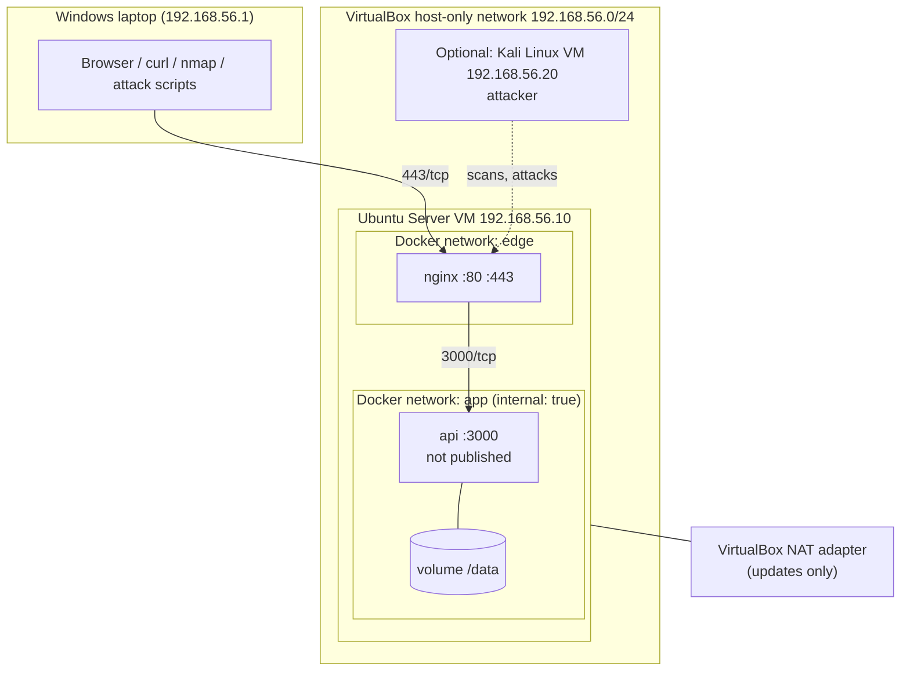
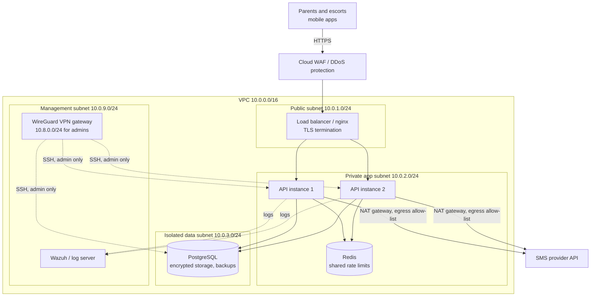

# KidsWay network design

Two versions of the same idea: a **lab** you can build on one Windows laptop with VirtualBox and Docker, and the **production** design it models. Both follow defence in depth: only one component faces the internet, the application is never directly reachable, and the data tier is reachable only from the application.

## 1. Lab topology (what you build)



### IP plan

| Device | Network | Address | Notes |
|---|---|---|---|
| Windows host | host-only | 192.168.56.1 | Admin workstation and test client |
| Ubuntu server VM | host-only | 192.168.56.10 (static) | Runs Docker, UFW, fail2ban |
| Ubuntu server VM | NAT | DHCP (10.0.2.x) | Outbound only, for package updates |
| Kali VM (optional) | host-only | 192.168.56.20 | Attacker machine |
| nginx container | Docker `edge` + `app` | assigned by Docker | Only container with published ports |
| api container | Docker `app` (internal) | assigned by Docker | No published ports, no internet route |

### Firewall rules (Ubuntu host, UFW)

| # | Direction | Source | Destination port | Action | Reason |
|---|---|---|---|---|---|
| 1 | in | any | 443/tcp | allow | The service |
| 2 | in | any | 80/tcp | allow | Redirect to HTTPS only |
| 3 | in | 192.168.56.0/24 | 22/tcp | allow, rate-limited | SSH from the admin network only |
| 4 | in | any | any | deny (default) | Everything else, including 3000 |
| 5 | out | VM | any | allow | Updates through NAT |

fail2ban adds temporary deny rules for IPs that produce 20 security events in 10 minutes (bad logins, wrong handover codes, rate-limit hits, forged links) and for SSH brute force.

### Expected scan result from the Windows host

```
nmap -sS -sV -p- 192.168.56.10
PORT    STATE SERVICE
22/tcp  open  ssh      (only from 192.168.56.0/24)
80/tcp  open  http     -> 301 to https
443/tcp open  ssl/http
```
Port 3000 (the API) must **not** appear. If it does, the segmentation is broken.

## 2. Production design (what the lab models)



### Security groups

| From | To | Port | Allowed |
|---|---|---|---|
| Internet | Load balancer | 443 | yes (80 redirects) |
| Load balancer | API subnet | 3000 | yes |
| API subnet | PostgreSQL | 5432 | yes |
| API subnet | Redis | 6379 | yes |
| API subnet | Internet | 443 to the SMS provider only | yes, via NAT gateway with an egress allow-list |
| VPN clients 10.8.0.0/24 | any internal host | 22 | yes, key-based, MFA on the VPN |
| Internet | API, database, Redis | any | **no**: these subnets have no public IPs |
| anything | anything else | any | no (default deny) |

### Why each choice

- **Single entry point**: only the load balancer has a public address, so there is one place to apply TLS policy, WAF rules and rate limits.
- **No public IPs on the app or data tier**: a mistake in an app config cannot expose the database to the internet.
- **Admin access only through the VPN**: no SSH port on the internet at all.
- **Egress allow-list**: if the API is compromised, it cannot send data to an arbitrary server; it can only reach the SMS provider.
- **Central logging** (Wazuh): security events from the API and the hosts in one place, with alerts.
