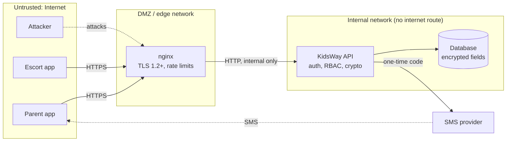

# KidsWay threat model

KidsWay is a children's escort service in Malaysia. A parent books an escort who picks a child up at point A and hands them over at point B (and C, D...) to a trusted person named in the booking. The handover is confirmed by a one-time code and a photo report, and the parent closes the trip.

The system holds some of the most sensitive data there is: **where a child is right now, what they look like, what they are allergic to, and who is allowed to take them.** A breach is not only a privacy problem, it is a physical safety problem.

Method: data-flow diagram, then STRIDE per element, then a control and a test for each threat.

## 1. Assets

| # | Asset | Why it matters | Where it lives |
|---|---|---|---|
| A1 | Child's live location | Shows where a child is, now | `locations`, only during an active trip, deleted at completion |
| A2 | Handover code | Decides who may physically receive the child | Only an HMAC of it is stored; shown to the parent once |
| A3 | Child profile: name, date of birth, allergies, notes | Health data, identifies the child | `children`, encrypted with AES-256-GCM |
| A4 | Handover photo | Image of the child and the receiver | `photos`, served only through 5-minute signed links |
| A5 | Parent and trusted-person phone numbers | Contact data, used for login | Stored as HMAC (lookup) + AES-GCM (display) |
| A6 | Sessions | Full access to a family's data | Only SHA-256 of the token stored, 30 min idle / 12 h absolute |
| A7 | Audit log | Evidence of who saw what | Append-only table (database triggers block UPDATE and DELETE) |
| A8 | Guardian applicants' MyKad numbers and documents (MyKad photos, selfie, certificates, e-DKK and police results) | Identity theft material; vetting evidence | `applicants` and `applicant_docs`, AES-256-GCM, opened only by vetting officers through 5-minute signed links |
| A9 | The vetting decision | Decides who is allowed to be alone with children | Checks with evidence, four-eyes approval, audit log |

## 2. Actors

- **Parent**: books trips, owns their children's data.
- **Escort**: sees only the trips assigned to them, and only while open.
- **Admin / support**: assigns trips, sets prices, reads the audit log.
- **Vetting officer**: an admin with the extra `vetting` permission; the only role that opens applications.
- **Applicant**: someone applying to be a Guardian; has a limited session that reaches only `/api/careers`.
- **Trusted receiver**: never logs in; only holds the handover code.
- **Attackers**: a person with a record who tries to get hired to reach children, a stranger at the school gate, another parent with a normal account, a curious or dishonest escort, someone who knows a parent's phone number, an outsider scanning the internet, someone who obtains a database copy.

## 3. Data flow and trust boundaries

Trust boundaries: (1) Internet to nginx, (2) nginx to the internal network, (3) API to database, (4) API to the SMS provider.

## 4. STRIDE analysis

| ID | STRIDE | Threat | Control in KidsWay | Verified by |
|---|---|---|---|---|
| S1 | Spoofing | A stranger claims to be the trusted person and guesses the handover code | 6-digit CSPRNG code per stop; 5 wrong tries lock the stop; escort limited to 10 checks/min; single use; expires; parent can re-issue | Tests T12, T13, T25; attack `handover-bruteforce` |
| S2 | Spoofing | Someone who knows a parent's phone number guesses the SMS login code | 6-digit code, 5-minute lifetime, burned after 5 wrong tries, bound to the phone number | T2, T3; attack `otp-bruteforce` |
| S3 | Spoofing | Stolen or forged session token | 256-bit random tokens, only SHA-256 stored, idle and absolute timeout, logout revokes | T5 |
| S4 | Spoofing | Self sign-up as escort or admin | Sign-up always creates a parent; staff accounts only by admin | T10 |
| T1 | Tampering | Changing a signed photo link to extend it or point it at another photo | HMAC-SHA256 over path and expiry, constant-time compare | T20; attack `photo-url-tamper` |
| T2 | Tampering | Copying encrypted data between rows in a stolen/modified database | AES-GCM with AAD = table, column and row id | T16 |
| T3 | Tampering | SQL injection | Prepared statements only; strict input validation | T23 |
| T4 | Tampering | Uploading a script or other file as a "photo" | Allow-list of types, magic-byte check, 2 MB limit, `nosniff` | T19 |
| R1 | Repudiation | "I never opened that child's file" / "the code was never entered" | Audit log of reads, denials, handovers, confirmations; append-only | T18 |
| I1 | Information disclosure | Another parent reads a child record by ID (IDOR / BOLA) | Ownership checks on every object; 404 instead of 403; 128-bit random IDs | T7, T8, T9; attack `idor-child-data` |
| I2 | Information disclosure | Database file or backup is stolen | Names, DOB, medical notes, addresses, receiver details and phone numbers encrypted; codes and tokens only hashed | T14, T15 |
| I3 | Information disclosure | Escort learns more than needed | Escort sees the child only during an assigned open trip, without date of birth or receiver phone | T9, T11 |
| I4 | Information disclosure | Location history kept forever | Location accepted only while a trip is in progress, deleted when the trip completes | T17 |
| I5 | Information disclosure | Account enumeration through the login form | Same response for known and unknown numbers | T1 |
| I6 | Information disclosure | Errors leak stack traces or SQL | Generic error codes; details only in server logs | T24 |
| I7 | Information disclosure | Traffic sniffed on public Wi-Fi | HTTPS only, TLS 1.2/1.3, HSTS, port 80 only redirects | nginx config; check with nmap / testssl in the lab |
| D1 | Denial of service | SMS bombing a parent / running up SMS costs | 3 codes per phone and 10 per IP per 10 minutes | T4 |
| D2 | Denial of service | Request floods, slow requests, huge bodies | nginx and app rate limits, timeouts, 64 KB JSON limit, fail2ban bans | T22; fail2ban in the lab |
| S5 | Spoofing | A handover code for a trip generated from a regular plan exists before the parent has it | Generated trips have **no** code until the parent issues one in the app; the escort gets "code not issued" | F6 |
| T5 | Tampering | Parent sends their own price in a booking | Prices are never accepted from the client: the server calculates every quote and stores the price with the trip; only the admin changes the price list | F1, T10 |
| I8 | Information disclosure | Another parent reads or stops someone's regular plan (BOLA) | Same ownership rule as trips, 404, audited; escorts cannot list plans | F7 |
| I9 | Information disclosure | Map points reveal where a child lives and studies | Coordinates encrypted like addresses (AES-GCM, own AAD); accepted only inside Malaysia | F2, F3, F10 |
| I10 | Information disclosure | Third-party map services see what the parent views and types | Tiles are images only; address search text goes to Nominatim, only when the user searches or moves the pin, max 1/s, only the origin as Referer; CSP allows exactly these two hosts | CSP in `app.ts`; E2E run |
| I11 | Information disclosure | Personal data left on a phone by the installable app | The service worker caches only public static files, never `/api` or photos; the session token is in sessionStorage and ends with the tab | `public/sw.js` review |
| E1 | Elevation of privilege | Parent calls admin endpoints | Role checks on every route | T10 |
| E2 | Elevation of privilege | Container escape after an RCE | Non-root user, read-only filesystem, all capabilities dropped, no-new-privileges, API on an internal-only network | docker-compose review |

## 4b. Hiring: who becomes a Guardian

The most dangerous attack on a children's escort service is not technical: it is **a person who should never be alone with children getting hired**. The hiring module (`src/hiring.ts`) is designed against that, and against the theft of applicants' identity documents.

| ID | STRIDE | Threat | Control | Verified by |
|---|---|---|---|---|
| H1 | Spoofing | Applying with someone else's identity or a fake MyKad | Phone proven by SMS; MyKad photos and a selfie checked by an officer; the identity check cannot pass without those files | G2, G6 |
| H2 | Spoofing | Someone outside the stated rule (women aged 20-55) applies | Age and gender read from the MyKad number on the server (birth date + last digit), not from a form field | G1 |
| H3 | Elevation of privilege | A person with a record of sexual offences against children is hired | Mandatory e-DKK check through JKM; pass only with the JKM result on file; yearly re-check; a failed re-check suspends the account, revokes sessions and frees her trips | G6, G9 |
| H4 | Elevation of privilege | One officer (corrupt, coerced or careless) approves alone | Four-eyes: N different officers must approve after every check passed; any new check result clears earlier approvals | G7 |
| H5 | Elevation of privilege | An admin creates an escort account and skips vetting | Direct escort creation is refused in production (`use_vetting`); accounts come only from final approval | code review, `app.ts` |
| H6 | Spoofing / repudiation | The same person applies again under another phone, or reuses someone's documents | HMAC of the MyKad and SHA-256 of every file reveal duplicates as officer-only flags (`duplicate_ic`, `doc_reused`); the sender gets the normal answer, so MyKad numbers cannot be probed | G3, G4 |
| H7 | Information disclosure | Theft of MyKad numbers and documents from a database copy | MyKad and every file encrypted (AES-GCM, row-bound AAD); only birth year kept in clear | G4 |
| H8 | Information disclosure | A dispatcher or another admin browses applicants' documents | Separation of duties: only the `vetting` permission opens files; each opening logged | G5 |
| H9 | Tampering / elevation | A malicious upload attacks the officer's computer (script in an "image", PDF with JavaScript) | File signatures checked; PDFs with JavaScript, launch actions, attachments, RichMedia or XFA refused; files served with `sandbox` CSP and `nosniff`; PDFs downloaded, not opened in the page | G4, G8 |
| H10 | Denial of service | Bots flood the application form | SMS step, per-IP and per-phone limits, nginx `apply` zone, honeypot field (nothing saved, `bot_blocked` logged) | G3, nginx config |
| H11 | Information disclosure | Applicants' data kept forever | Withdraw erases everything at once; rejected files erased after 180 days by the scheduler | G10, G11 |

| H12 | Spoofing | A printed photo, a screen or another person is shown for the selfie | Active liveness: 3 prompts in a random order chosen by the server, single-use challenge valid 3 minutes; head-turn, same-person and motion checks; selfie only from the live camera | V1, V5, verifier tests |
| H13 | Spoofing | Someone sends forged results to the API pretending to be the verifier, or calls the verifier directly | Verifier only on an internal network shared with the API; HMAC-signed requests with timestamp and replay protection; the API calls it, never the browser | V2, verifier `SigningTests`, compose |
| H14 | Elevation of privilege | The AI wrongly rejects or wrongly accepts someone | AI only suggests; max 3 attempts, then an officer; the officer decides identity and must write a reason to pass against the AI | V4, V8 |
| H15 | Information disclosure | Face data (biometric, sensitive under the PDPA since the 2024 amendment) kept or leaked | Separate, optional consent; without it no face processing at all; embeddings live only in memory; only scores stored, encrypted; head-turn frames never stored; the applicant never sees scores (they would help tune a fake) | V2, V3, V7 |
| H16 | Tampering | Malicious images attack the AI service (decoder bugs, decompression bombs) or a swapped model | File signature and header size checked before decoding, in-memory only; models pinned by SHA-256 at download and start | verifier `ImageIntakeTests`, `ModelIntegrityTests` |

Limits: the e-DKK check itself is done by JKM, outside this system; the officer uploads the result. The AI face check (verifier/) uses open models: active liveness is weaker than certified eKYC against masks and deepfakes, and error rates may differ between groups of people, so a person always decides. The legal basis for the women-only, 20-55 requirement should be confirmed with a lawyer before launch (Employment Act anti-discrimination provisions).

## 4c. Three apps on one API

KidsWay is split like a ride-hailing company: **KidsWay** (parents, `/`), **KidsWay Guardian** (escorts and applicants, `/guardian/`), **KidsWay Control** (staff, `/control/`).

| ID | STRIDE | Threat | Control | Verified by |
|---|---|---|---|---|
| X1 | Elevation of privilege | A staff account is used from a consumer device or app (shared phone, weaker habits), widening where an admin token lives | A role signs in only through its own app (`wrong_app`); the check runs after the SMS code, so it reveals nothing about the number | A1, A2, A4 |
| X2 | Spoofing | Someone signs up through the Guardian or Control app to get an escort or staff account | No self sign-up there (`not_a_guardian`, `not_staff`); Guardians come only from Hiring, staff only from an admin | A3 |
| X3 | Elevation of privilege | A stolen or forgotten staff session opens every family's data for hours | Sessions bound to their app; Control sessions expire after 15 idle minutes, 8 hours at most; a session stops when the account's role changes | A5, A6 |
| X4 | Information disclosure | Parents' devices download and cache the staff console, showing every admin function and endpoint | Each page loads only the shared core and its own file; each service worker caches only its own app | A7 |
| X5 | Elevation of privilege | A bug in one app uses a device permission it does not need | `Permissions-Policy` per app: camera only in Guardian, GPS in Guardian and the parent app, nothing in Control | A7 |

Limit: in the lab the three apps share one origin, so the browser does not isolate their storage; each app uses its own session key. Production should use separate subdomains, with `control.` reachable only through the staff VPN.

## 5. Risk rating (before and after)

Likelihood and impact on a 1-3 scale; risk = L x I.

| Threat | Before (v0 design) | After (v1) | Main remaining risk |
|---|---|---|---|
| S1 handover code guessing | 3 x 3 = **9** (4-digit, unlimited tries: cracked in seconds) | 1 x 3 = 3 | Code shared over an insecure channel by the parent |
| S2 SMS code guessing | 3 x 3 = **9** | 1 x 3 = 3 | SIM-swap fraud (outside the app's control) |
| I1 IDOR on child data | 2 x 3 = **6** | 1 x 3 = 3 | Logic bugs in new endpoints: keep test T7 style tests for each |
| I2 stolen database | 2 x 3 = **6** | 1 x 2 = 2 | Key theft from the same server: use a secrets manager in production |
| D1 SMS bombing | 3 x 2 = **6** | 1 x 2 = 2 | Distributed attacks from many IPs |
| H3 unsafe person hired | 2 x 3 = **6** (manual hiring, no required evidence) | 1 x 3 = 3 | Offences not yet in the register; mitigated by references, interview, shadow trip and parent ratings |

## 6. Malaysia: Personal Data Protection Act 2010 (PDPA)

How the design supports the PDPA principles (this is a design note, not legal advice):

- **Notice and choice / disclosure**: data is only used for the trip; the escort sees the minimum needed.
- **Security principle**: encryption at rest, TLS in transit, access control, audit log.
- **Retention**: location trail deleted at trip completion; photo retention should be limited (planned: 30 days); rejected job applications erased after 180 days, withdrawn ones at once.
- **Consent**: applicants give explicit consent (versioned, time-stamped) to the e-DKK and police checks and to reference calls.
- **Data integrity and access**: parents can view and delete their child's profile (`DELETE /api/children/:id`).
- Children's data is collected only from the parent, never from the child.

## 7. Out of scope / known limits

- The rate limiter is in memory: it resets on restart and does not share counts between several API instances. Production: Redis or the database.
- SQLite is used to keep the project dependency-free. The production design moves the database to PostgreSQL in its own subnet (see `network-design.md`).
- Live location uses polling; production would use WebSockets over TLS with the same authorisation rules.
- Map tiles and address search use the free OpenStreetMap services, which have fair-use limits. A real launch would use a paid provider or a self-hosted tile and geocoding server, which would also keep searched addresses inside the company.
- The plan scheduler runs inside the API process every 30 minutes. With several API instances it needs a single scheduler (a job queue or a database lock); the unique index on plan, date and leg already prevents duplicate trips.
- SMS sending is wired for Twilio (`src/sms.ts`) but was not tested against a live account.
- Mobile app security (certificate pinning, secure storage on the phone, jailbreak detection) is not covered here.
